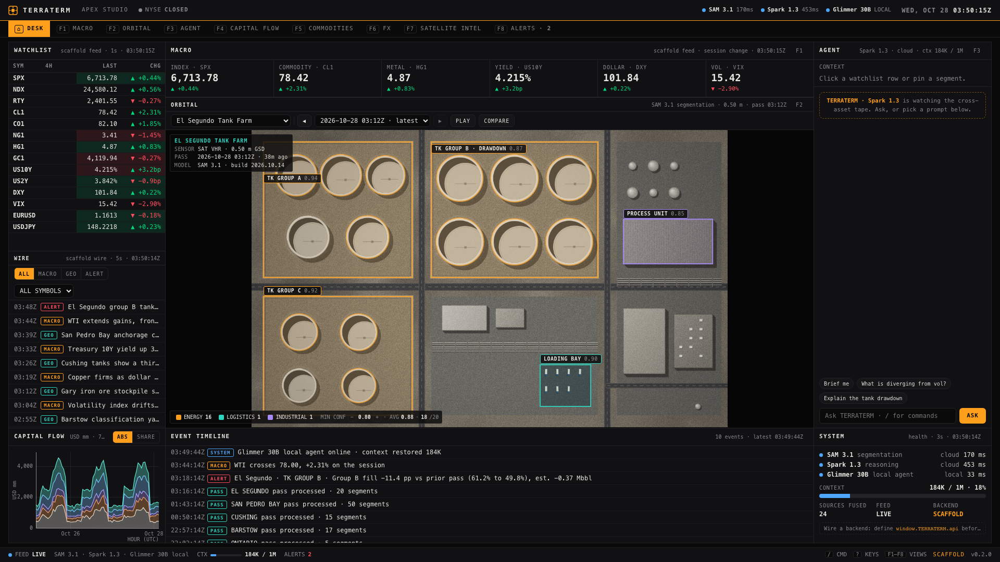
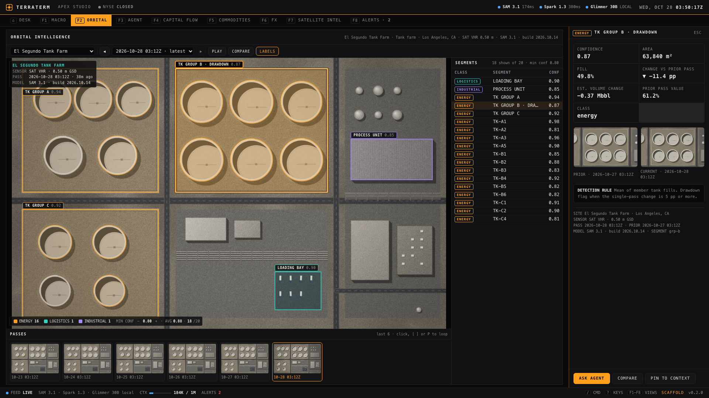
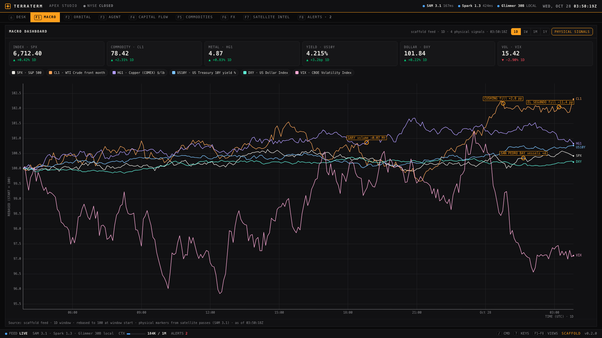
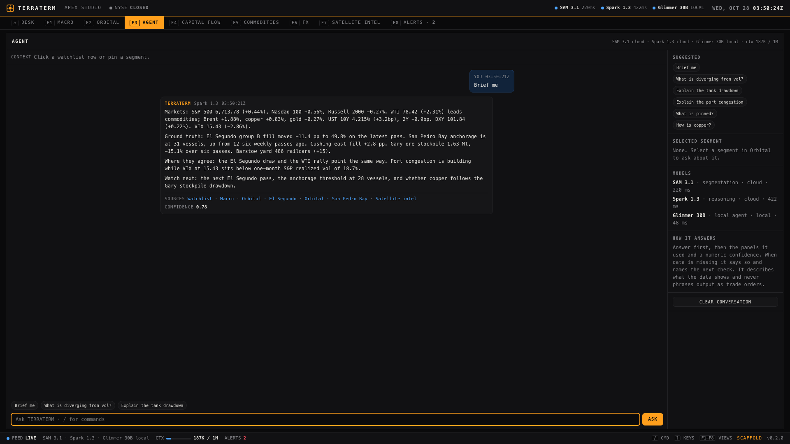

# TERRATERM

> The terminal Wall Street knows, pointed at the physical world.

Macro markets on the left, segmented satellite imagery in the center, and an agent that reasons across both on the right. Keyboard-first, dark, single-file, and offline by default.

   



## Screenshots

| Orbital — segment drawer | Macro — physical signals |
|---|---|
|  |  |

| Agent | |
|---|---|
|  | The agent answers first, then shows the panels it used, a numeric confidence, and what it could not see. It describes what the data shows — it never phrases output as trade orders. |

## What it does

- **Desk (six panels, resizable and reorderable):** watchlist + wire, macro KPIs + compact orbital viewer, agent, capital flow, event timeline, and system health. Layout is saved per browser.
- **Orbital intelligence:** satellite passes with segment overlays by class, HUD provenance (sensor, GSD, pass time, model), confidence filtering, prior-pass compare slider, pass loop, filmstrip, and a segment drawer with crops, detection rule, and provenance.
- **Agent:** streaming answers fused from market and imagery context, with clickable sources, two-decimal confidence, explicit "missing" items, and Esc-to-stop. Prompts, pins, and segments travel as structured context.
- **Macro, flow, commodities, FX, satellite intel, alerts:** eight full views (F1–F8), sortable 200-row tables with sparklines, capital-flow stacking (ABS/SHARE), a site mission-control table, and an alerts inbox with a threshold rules builder.
- **Live or scaffold backend:** wire a real backend via `window.TERRATERM.api` (see [CONTRACT.md](CONTRACT.md)) — or run the built-in synthetic scaffold, always labeled `SCAFFOLD` in the status bar and System panel. Live mode never fills gaps with synthetic data.

## Quick start

No install is needed to use it. Open the standalone build in a browser — it is one self-contained file with no network calls:

```text
dist/terraterm.html
```

| Task | Command |
|---|---|
| Serve the build | `node scripts/serve.mjs` → open http://localhost:5173 |
| Serve the unbundled source (edit and refresh) | `node scripts/serve.mjs --src` |
| Rebuild `dist/` from `src/` | `node scripts/build.mjs` |
| Run the full test suite | `npm install && npx playwright install chromium && npm test` |

Build and serve need Node 18+. The test suite needs Node 20+ (locked Playwright). All scripts run offline.

Try it once it is open: `#demo` (scripted 90-second run — see [docs/DEMO.md](docs/DEMO.md)), `#/orbital/ela-segundo-tanks/grp-b` (drawer open on the drawdown), `#/commodities/CLZ6`.

## Keyboard

`F1`–`F8` views (`Alt+1`–`Alt+8` if the browser keeps a function key) · `Alt+0` desk · `/` command palette · `?` shortcut sheet · `Esc` close or back · `A` ask box · `[` `]` passes · `P` play loop · `C` compare · `L` labels · `T` ticker tape · `N` next demo beat · `Alt+Shift+Arrows` move a desk panel.

## Wiring a backend

Define `window.TERRATERM.api` with `watchlist`, `macro`, `imagery`, and `ask` before the app script. Optional methods (`sites`, `quotes`, `series`, `flow`, `wire`, `events`, `system`) that you leave out stay off in live mode — their panels stay empty and the System panel lists them. `api` may be a plain object or a class instance. Full shapes, polling budgets, and routes are in [CONTRACT.md](CONTRACT.md); [docs/backend.example.js](docs/backend.example.js) is a fetch-based adapter with a streaming `ask`.

## Architecture

```text
src/
  index.html            entry; script order matters (core → mock → ui → shell)
  css/tokens.css        design tokens (colors, type, spacing, motion, segment classes)
  css/app.css           every component, built only from tokens
  js/core.js            rng, DOM helper, formatting, bus, storage, throttle, fuzzy search, NYSE calendar
  js/mock/              scaffold backend: data, scenes (6 sites × 6 passes), market sim, agent, api
  js/ui/                imagery renderer, charts, kit (panels, toasts, drawer, poller), state,
                        orbital viewer, agent panel, desk, full views, palette, shell (router, keys, demo, boot)
dist/terraterm.html     standalone build (open this one)
dist/terraterm.artifact.html   body-only build for hosts that supply <html>/<head>
test/acceptance.mjs     63 checks; writes test/out/report.json and report.md
test/regression.mjs     17 regression probes (exit 1 on any regression)
docs/                   DEMO.md (one-pager), COMPONENTS.md (per screen), backend.example.js, screenshots/
```

Polling is budgeted (quotes 1 s, events 2 s, system 3 s, wire 5 s, sites 15 s, flow 30 s) with exponential backoff and a 4× slowdown while the tab is hidden. Imagery is cached per site/pass with rolling-window reconciliation; charts re-render at most twice per second.

## Testing

```bash
npm test        # build + 63 acceptance checks + 17 regression probes
npm run test:regression
```

Latest verified run: **63/63 acceptance + 17/17 probes, Chromium 156** (report in `test/out/`).

## License

**Proprietary — all rights reserved.** This is not open-source software. No use, copying, modification, or distribution is permitted without a prior signed written license from the copyright holder. See [LICENSE](LICENSE) for the strict terms.
